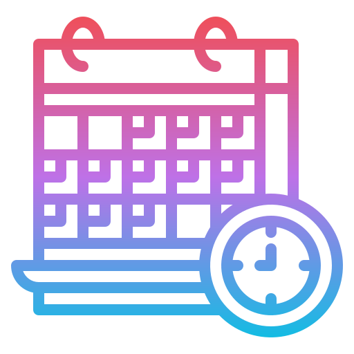

<div align="center">



# Daily Habit Tracker

### Build Better Habits — One Day at a Time

*A production-grade Flutter app with clean architecture, Firebase Firestore, and BLoC state management.*


</div>

---

## Overview

**Daily Habit Tracker** is a **production-ready Flutter application** built with strict **Clean Architecture** principles and **Firebase Firestore** as the real-time backend. Users can create daily habits, track their completion, earn points, and visualize their 7-day streak — all synced to the cloud with offline support.

This project was built as part of a **Phase 2 hiring assignment**, demonstrating real-world Flutter development with:
- Full **Clean Architecture** separation (domain / data / presentation)
- Real **Firebase Firestore** backend (zero mock/hardcoded data)
- **BLoC (Cubit)** state management with optimistic updates
- **Swipe-to-delete** with Firestore batch operations
- **Offline persistence** with instant local cache reads

---

## Screens

| Today's Habits | Add Habit | Habit Detail |
|---|---|---|
| View & toggle daily habits, see points earned, track progress | Create habits with name, description, points, and optional icon | 7-day streak visualization, stats, done/undone toggle |

### Features at a Glance

- ✅ **Today's Habits** — list with tap-to-toggle done/undone
- ✅ **Progress Header** — total points earned, completion ratio
- ✅ **Add Habit** — form with validation, 24 icon choices (optional)
- ✅ **Habit Detail** — 7-day streak chart, point stats, toggle
- ✅ **See All Habits** — full habits list
- ✅ **Swipe-to-Delete** — on both Today and See All screens, removes habit + all history atomically via Firestore batch
- ✅ **Optional Icons** — letter fallback when no icon selected
- ✅ **Offline Support** — Firestore offline persistence enabled
- ✅ **Optimistic UI** — instant feedback, reverts on error

---

## Architecture

This project follows **Clean Architecture** with strict layer separation. The domain layer contains **zero Flutter or Firebase imports** — it is pure Dart.

```
lib/
├── core/
│   ├── di/               # GetIt dependency injection
│   ├── error/            # Failures & Exceptions
│   ├── router/           # GoRouter navigation
│   ├── theme/            # App colors & theme
│   ├── usecases/         # UseCase base class + NoParams
│   ├── utils/            # date_helpers, habit_icons, view_status
│   └── widgets/          # Shared widgets (BlobDecoration)
│
└── features/
    └── habits/
        ├── domain/           ← Pure Dart, no Flutter/Firebase
        │   ├── entities/     # EntityHabit, EntityHabitDetail, EntityStreakDay …
        │   ├── repositories/ # RepositoryHabit (abstract)
        │   └── usecases/     # UcGetTodayHabits, UcAddHabit, UcToggleHabit …
        │
        ├── data/             ← Firebase lives here only
        │   ├── datasources/  # HabitRemoteDataSource (Firestore)
        │   ├── models/       # ModelHabit (fromDoc, toEntity)
        │   └── repositories/ # ImplHabitRepository
        │
        └── presentation/     ← Flutter UI
            ├── cubit/        # CubitTodayHabits, CubitAddHabit …
            └── pages/        # PageToday, PageAddHabit, PageHabitDetail, PageAllHabits
```

### Data Flow

```
UI (Page)
  └─► Cubit (BLoC)
        └─► UseCase (domain)
              └─► Repository Interface (domain)
                    └─► ImplHabitRepository (data)
                          └─► HabitRemoteDataSource
                                └─► Firebase Firestore
```

---

## Firestore Schema

```
habits/{habitId}
  ├── name        : String
  ├── description : String
  ├── points      : Number
  ├── iconName    : String   (e.g. "water", "book" — empty = no icon)
  └── createdAt   : Timestamp

completions/{habitId}_{yyyy-MM-dd}
  ├── habitId     : String
  ├── dateKey     : String   (e.g. "2026-10-19")
  └── completedAt : Timestamp
```

Delete a habit → batch deletes `habits/{id}` **and** all `completions/{id}_*` atomically.

---

## Tech Stack

| Package | Version | Purpose |
|---|---|---|
| `flutter_bloc` | ^8.1.6 | Cubit-based state management |
| `freezed` / `freezed_annotation` | ^3.0.0 | Immutable models & states |
| `dartz` | ^0.10.1 | `Either<Failure, T>` functional error handling |
| `get_it` | ^7.7.0 | Service locator / dependency injection |
| `go_router` | ^14.2.0 | Declarative navigation |
| `cloud_firestore` | ^5.4.0 | Real-time NoSQL database |
| `firebase_core` | ^3.4.0 | Firebase initialization |
| `google_fonts` | ^6.2.1 | Premium typography (Outfit, Inter) |
| `path_provider` | ^2.1.4 | Required by google_fonts |

---

## Getting Started

### Prerequisites

- Flutter `>=3.6.0`
- Dart `>=3.6.0`
- A Firebase project with **Firestore** enabled

### Setup

**1. Clone the repository**
```bash
git clone https://github.com/NaveedBhat/habit_tracker.git
cd habit_tracker
```

**2. Add Firebase configuration**

This file is excluded from the repo for security. You need to add your own:

- Android: place `google-services.json` in `android/app/`
- iOS: place `GoogleService-Info.plist` in `ios/Runner/`

Use the [FlutterFire CLI](https://firebase.flutter.dev/docs/cli) to generate these:
```bash
dart pub global activate flutterfire_cli
flutterfire configure
```

**3. Install dependencies**
```bash
flutter pub get
```

**4. Run the app**
```bash
flutter run
```

---

## Use Cases

| Use Case | Responsibility |
|---|---|
| `UcGetTodayHabits` | Fetch all habits + today's completions in parallel |
| `UcGetAllHabits` | Fetch all habits (no completion data) |
| `UcAddHabit` | Validate and create a new habit |
| `UcToggleHabit` | Mark habit done/undone for today |
| `UcDeleteHabit` | Delete habit + all completion history (batch) |
| `UcGetHabitDetail` | Fetch habit + 7-day streak in parallel |

---

## AI-Assisted Development

This project was built using **[Antigravity by Google DeepMind](https://antigravity.dev)** as the AI pair-programming tool.

### Example Prompts Used

> *"Build a Flutter habit tracker with clean architecture — domain/data/presentation layers, flutter_bloc Cubits, freezed entities, dartz Either, get_it DI, go_router, Firestore backend. Zero mock data."*

> *"Add swipe-left to delete using Dismissible with optimistic removal, red delete background, confirmation dialog, and Firestore batch delete for habit + all completion records."*

> *"Move `FirebaseFirestore.instance.settings` to main.dart before configureDependencies() — setting it inside the data source constructor crashes on hot restart."*

### Where I Guided the AI

The AI initially placed `_db.settings = const Settings(persistenceEnabled: true)` inside the `HabitRemoteDataSource` constructor. This caused a fatal `FirebaseException: Firestore settings cannot be changed` crash on every hot restart, because Firestore was already initialized before the constructor ran again. I identified the root cause and directed the AI to move the settings call to `main.dart`, immediately after `Firebase.initializeApp()` and before any other Firestore operation.

### Architecture Verification

To verify the domain layer purity (a core Clean Architecture requirement), I ran:
```bash
grep -rn "import 'package:cloud_firestore" lib/features/habits/domain/
grep -rn "import 'package:flutter"          lib/features/habits/domain/
```
Both returned **zero results** — confirming the domain layer is pure Dart with no framework dependencies.

---

## Project Highlights

- **Optimistic UI** — toggles and deletes update instantly in the UI; if the Firestore operation fails, the state is reverted and an error snackbar is shown
- **Parallel Firestore fetches** — `Future.wait([getHabits(), getCompletedIds()])` halves cold-start latency
- **Offline persistence** — `Settings(persistenceEnabled: true, cacheSizeBytes: CACHE_SIZE_UNLIMITED)` means the app works without internet
- **Architecture purity** — domain layer verified to have zero Flutter/Firebase imports
- **Icon optional** — habits default to a letter avatar; user can optionally pick from 24 icons

---

## License

This project is for evaluation/assignment purposes.

---

<div align="center">

Built with ❤️ by **Naveed Bhat**

[](https://linkedin.com/in/naveedbhat)
[](https://github.com/NaveedBhat)

</div>
